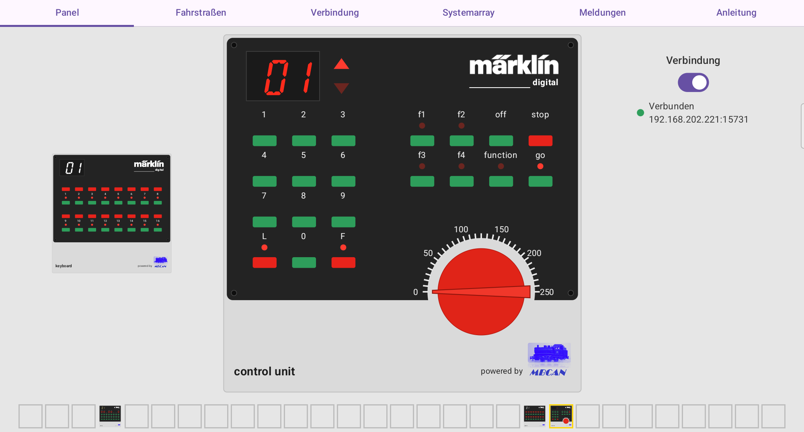
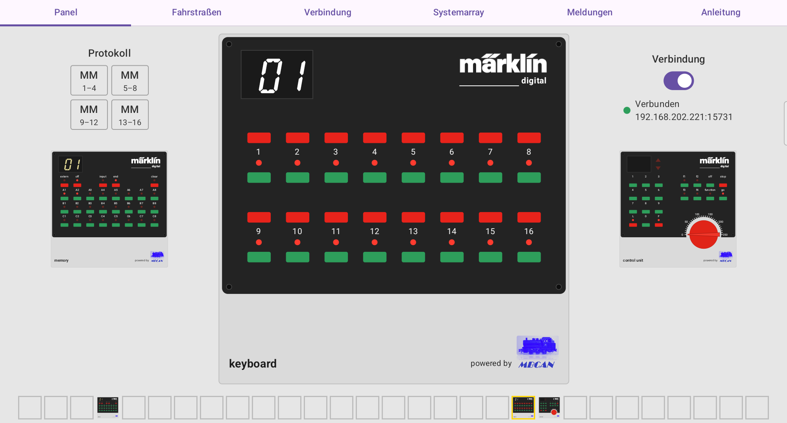
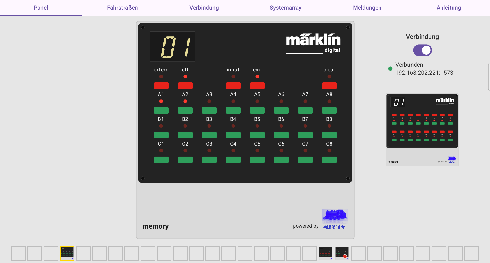
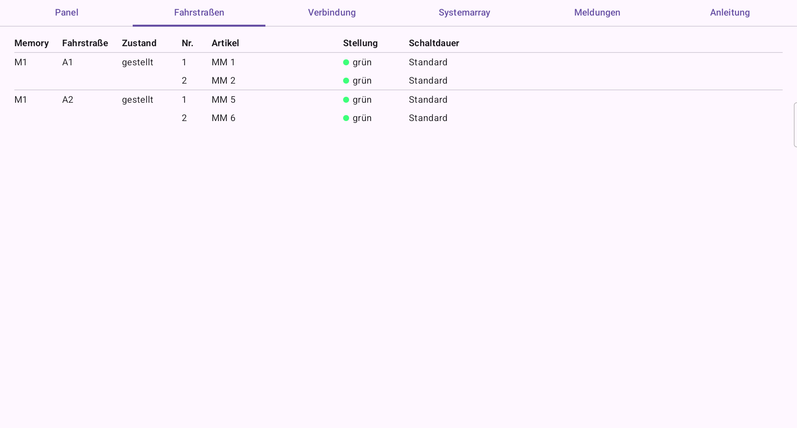
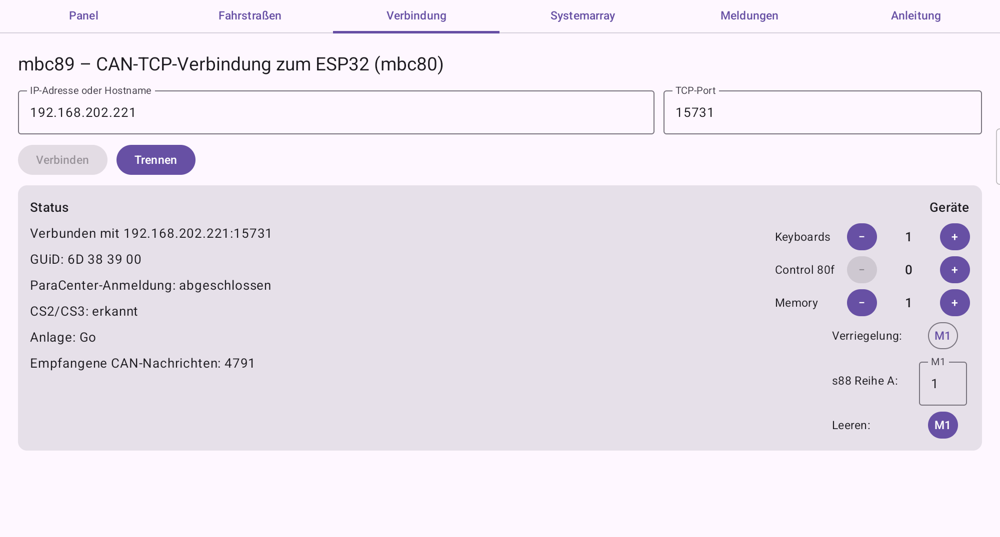
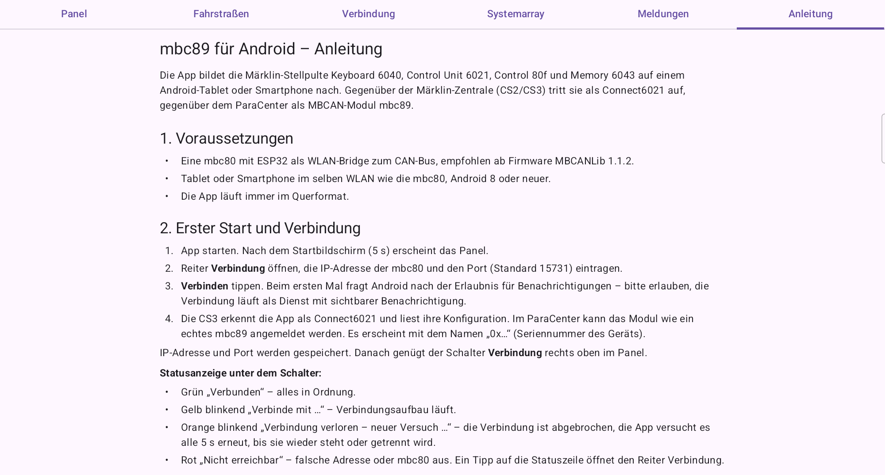

# mbc89-APP – mbc-89 für Android

Android-App, die das Connect6021-Interface **mbc-89** samt seiner Märklin-Stellpulte auf einem
Tablet oder Smartphone nachbildet: **Control Unit 6021**, bis zu acht **Control 80f**, bis zu 16
**Keyboards 6040** und bis zu vier **Memory 6043**. Die App verbindet sich per WLAN mit einer
**mbc-80** (ESP32-C3) und tritt am CAN-Bus gegenüber der CS2/CS3 als Connect6021 und gegenüber dem
Parametriercenter als MBCAN-Modul mbc-89 auf.

## Funktionen

- Control Unit 6021 / Control 80f: Lokadresse 01–80, Fahrstufe, Richtung, Funktionen, L/F mit
  eigener Funktionsdecoder-Adresse, stop/go.
- Keyboard 6040: 16 Magnetartikel je Keyboard, MM oder DCC je Tastengruppe, LED-Nachführung vom Bus.
- Memory 6043: 24 Fahrstraßen je Memory mit Schaltdauer je Befehl, Folgefahrstraßen,
  Kreuzungsprüfung, Verriegelung und s88-Automatik nach dem Märklin-Handbuch; Zustand bleibt über
  Neustarts erhalten.
- Anmeldung an CS2/CS3 (Konfigurationskanäle) und am Parametriercenter (Systemarray).
- Automatische Wiederverbindung, Meldungsliste, Fahrstraßenliste und eingebaute deutsche Anleitung.
- Mehrere Geräte gleichzeitig an derselben mbc-80.

## Ansichten

Control Unit 6021 mit aufgerufener Lok, Verbindungsschalter und Übersicht aller Pulte in der Fußzeile:



Keyboard 6040 mit der Protokoll-Anzeige (MM/DCC je Tastengruppe):



Memory 6043 mit zwei gestellten Fahrstraßen und die Fahrstraßenliste:





Reiter Verbindung mit Status und Geräteeinstellungen sowie die eingebaute Anleitung:





## Voraussetzungen

- mbc-80 mit ESP32-C3 als WLAN-Bridge, Firmware ab **MBCANLib 1.1.2** (siehe
  [MBCANLib](../../Module/MBCANLib) und [Mbc80Lib](../../Module/Mbc80Lib)).
- Android 8.0 oder neuer, Tablet oder Smartphone, Querformat.
- Getestet mit Samsung Galaxy Tab S6 Lite (SM-P620) und Galaxy S23 (SM-S911B) an einer CS3.

## Fertige App installieren

1. [Release/mbc89-APP-1.0.0.apk](Release/mbc89-APP-1.0.0.apk) auf das Gerät laden.
2. Die Installation aus dieser Quelle erlauben (Android fragt beim Öffnen der Datei nach).
3. App starten, im Reiter **Verbindung** die IP-Adresse der mbc-80 und den Port 15731 eintragen und
   **Verbinden** tippen.

Die Bedienung beschreibt die [Anleitung](app/src/main/assets/anleitung.md), die auch in der App im
Reiter **Anleitung** steht.

## App selbst bauen

Benötigt werden **JDK 17** und das **Android SDK** (Plattform 35). Am einfachsten geht es mit
Android Studio: den Ordner `mbc89_APP` öffnen und **Run** wählen.

Ohne Android Studio, im Ordner `mbc89_APP`:

```
gradlew assembleDebug
```

Unter Linux und macOS heißt der Aufruf `./gradlew assembleDebug` (falls nötig vorher
`chmod +x gradlew`). Die APK liegt danach in `app/build/outputs/apk/debug/app-debug.apk`. Die Unit-Tests laufen mit
`gradlew testDebugUnitTest`.

Für eine eigene signierte Release-Fassung einen Schlüssel anlegen und daneben eine Datei
`keystore.properties` ablegen (beide werden nicht eingecheckt):

```
storeFile=mein-schluessel.jks
storePassword=...
keyAlias=...
keyPassword=...
```

Danach erzeugt `gradlew assembleRelease` die signierte APK in `app/build/outputs/apk/release/`.

**Hinweis zur Seriennummer:** Die App bildet ihre Seriennummer aus der Android-ID des Geräts. Diese
hängt vom Signaturschlüssel ab. Eine selbst gebaute oder anders signierte Fassung meldet sich daher
an CS3 und Parametriercenter als neues Modul.

## Aufbau des Projekts

| Pfad | Inhalt |
| --- | --- |
| `app/src/main/java/de/mbc89/android/core` | Protokoll-Core ohne Android-Abhängigkeit: Connect6021, Parametriercenter, CS2-Konfiguration, Lokdatenbank, Memory-Logik |
| `app/src/main/java/de/mbc89/android/transport` | TCP-Verbindung zur mbc-80, 13-Byte-CAN-Pakete |
| `app/src/main/java/de/mbc89/android/storage` | Speicherung (DataStore): Identität, Systemarray, Einstellungen, Fahrstraßen |
| `app/src/main/java/de/mbc89/android` | Dienst, Oberfläche (Compose) und Pulte |
| `app/src/main/assets/anleitung.md` | Bedienungsanleitung |
| `app/src/test` | Unit-Tests |
| `Release` | Fertige, signierte APK |
| `Bilder` | Bildschirmansichten für dieses README |

## Version

**1.0.0** (07.11.2026) – erste veröffentlichte Fassung.

## Lizenz

Quellcode unter [MIT](../../../../LICENSE.txt), Anleitung und README unter
[CC BY-SA 4.0](https://creativecommons.org/licenses/by-sa/4.0/legalcode.de), wie im
[Haupt-README](../../../../README.md) beschrieben. Die Schrift „Digit“ (paldave, dafont.com) ist
als „100 % free“ gekennzeichnet; der märklin-Schriftzug stammt aus Wikimedia Commons
(`Logo_Märklin.svg`, gemeinfrei als reines Textlogo). Märklin, Central Station, Control Unit,
Keyboard, Memory und Connect 6021 sind Marken ihrer Inhaber; die App ist kein Produkt dieser Firmen.
